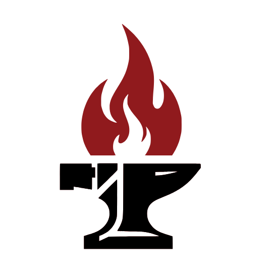

# Design Forge — Studio Portfolio & Interactive Archive

<div align="center">



### Delhi's Premier Visual Identity & Logo Design Studio
*Enduring vector marks, tactile print collateral, and bespoke brand systems engineered to outlast market trends.*

[](https://react.dev/)
[](https://www.typescriptlang.org/)
[](https://vitejs.dev/)
[](https://tailwindcss.com/)
[](LICENSE)

</div>

---

## 🏛️ Executive Overview

**Design Forge** is an independent visual identity and graphic design studio headquartered in Delhi, India. Founded on the conviction that enduring visual communication cannot be discovered through superficial trends or template marketplaces—it must be **forged** through disciplined craftsmanship, strategic inquiry, and optical precision.

Like a blacksmith transforming raw metal through heat, hammer, and anvil, Design Forge takes ambitious client visions and crafts them into high-conviction brand marks, tactile stationery suites, environmental murals, and responsive digital interfaces.

This repository hosts the studio's official digital platform and interactive portfolio archive, styled in an industrial architectural library aesthetic inspired by Trove.

---

## 📊 Studio Metrics & Proof of Work

| Metric | Achievement | Description |
| :--- | :---: | :--- |
| **Active Operation** | **6+ Years** | Continuously delivering identity solutions since 2020. |
| **Projects Delivered** | **150+ Works** | Spanning logos, print campaigns, civic posters, and packaging. |
| **Client Retention** | **95%** | Repeat collaborations across multi-year brand expansions. |
| **Average Rating** | **4.5★ / 5.0** | Verified client feedback across national and global engagements. |
| **Headquarters** | **Delhi, NCR** | Working with startups, enterprises, and cultural leaders worldwide. |

---

## 🔨 The 5-Phase Forging Process

Every commission undertaken by Design Forge adheres to a disciplined 5-stage production methodology:

```
[ 01 · Research ] ──> [ 02 · Sketch ] ──> [ 03 · Forge ] ──> [ 04 · Polish ] ──> [ 05 · Deliver ]
  Audits & Whitespace   Concept Ideation    Vector Crafting     Stress-Testing      Handoff & Manuals
```

1. **01 · Research & Audit**: We analyze your sector whitespace, target demographics, and competitor visual strategies before sketching a single mark.
2. **02 · Sketch & Ideation**: Structural directions are explored across black-and-white silhouettes, moodboards, and geometric grids.
3. **03 · Forge & Precision Vectoring**: Marks are constructed with mathematical harmony, optical weight balancing, and intentional chromatic systems.
4. **04 · Polish & Real-World Testing**: Collateral is stress-tested on real substrates—newsprint, embroidered apparel, architectural stone, and outdoor signage.
5. **05 · Deliver & Brand Governance**: Master delivery packages (AI, EPS, SVG, PDF, PNG) accompanied by a comprehensive Brand Standards Manual.

---

## 💼 Core Service Capabilities

| Discipline | Core Focus | Standard Deliverables | Typical Turnaround |
| :--- | :--- | :--- | :---: |
| **Logo Design** | Distinctive, memorable marks built for cross-medium scalability. | Primary & secondary vector marks, monochrome variants, typography pairing, file suite. | 1 – 2 Weeks |
| **Brand Identity** | Complete visual ecosystems linking digital and physical touchpoints. | Comprehensive logo suite, color palette hierarchy, typography guidelines, comprehensive brand manual. | 3 – 4 Weeks |
| **Social Media Design** | Scroll-stopping editorial campaigns and conversion-focused templates. | Multi-format post templates, story design kits, ad creatives, grid system guidelines. | 1 – 2 Weeks |
| **UI/UX Design** | Purposeful interfaces engineered for seamless user journeys. | Information architecture, wireframes, high-fidelity responsive screens, design tokens. | 4 – 6 Weeks |
| **Poster & Print** | High-impact tactical print collateral and exhibition materials. | Event posters, flyers, corporate stationery, press-ready CMYK files with bleed and trim. | 3 – 5 Days |
| **Design Consultancy** | Strategic creative direction and brand audits for founders. | Visual positioning audit, competitor benchmarks, creative strategy brief. | 1 Week |

---

## 🖼️ Active Mockup Portfolio Roster

All active portfolio entries feature verified, real-world mockups. Non-mockup concepts are archived separately.

| ID | Title | Category | Client Partner | Substrate / Medium |
|:---:|:---|:---:|:---|:---|
| **8** | **Elysium Logo** | Logos | Elysium | Embroidered polo shirt chest insignia |
| **15** | **Oh Wow Gifts Logo** | Logos | Oh Wow Gifts | Circular hanging blade sign on brick storefront |
| **5** | **T-Shirt Designs** | Branding | Namespace BPIT | Streetwear apparel with 3D isometric graphics |
| **26** | **Aggarwal Living Mural** | Branding | Aggarwal Living | Large-scale reception lobby modular puzzle mural |
| **2** | **Festival Story Design** | Digital | Rotaract District 3012 | Smartphone in-hand Instagram story template |
| **6** | **Safdurjung Photowalk** | Digital | Opticlick | Framed easel poster for Safdurjung photowalk |
| **10** | **Cirola Pamphlet** | Print | Ciróla | Commercial fresh-produce multi-fold pamphlet |
| **11** | **Aggarwal PG Cards** | Print | Aggarwal Living | Hospitality identity cards on polished marble |
| **12** | **Darima Cheese** | Print | Darima Cheese | Artisanal gourmet cheese flyer |
| **3** | **Take A Brain Break** | Print | Mental Health Initiative | Postcard flyer with crimson envelope stationery |
| **9** | **Quantum Cybershield** | Print | BPIT Research | Framed academic wall poster on quantum encryption |
| **20** | **Education Poster** | Print | S.D. Public School | Civic educational infographic in architectural wood frame |

---

## ⚡ Technical Architecture

The platform is engineered as a high-performance Single Page Application (SPA) with zero external backend dependencies:

- **Framework**: [React 19](https://react.dev/) + [TypeScript](https://www.typescriptlang.org/)
- **Bundler**: [Vite 8](https://vitejs.dev/) with native ES modules and lightning-fast HMR
- **Styling**: [Tailwind CSS v4](https://tailwindcss.com/) + custom Trove design tokens
- **Animations**: [Motion](https://motion.dev/) (Framer Motion) + custom canvas physics
- **Icons**: [Lucide React](https://lucide.dev/)
- **Search Engine Optimization**:
  - `Schema.org` JSON-LD `@graph` with `WebSite` Sitelinks SearchBox & `SiteNavigationElement` array
  - Dynamic route-based `document.title` and OpenGraph metadata
  - Automated XML sitemap (`/sitemap.xml`) and crawler configuration (`/robots.txt`)
  - Google Search Console verification tokens pre-configured

---

## 🛠️ Local Development & Scripts

### Prerequisites
- [Node.js](https://nodejs.org/) (v18.0.0 or higher recommended)
- `npm` (v9+) or `pnpm`

### Setup Instructions

1. **Clone the repository**:
   ```bash
   git clone https://github.com/yashvasudeva1/design_forge.git
   cd design_forge
   ```

2. **Install dependencies**:
   ```bash
   npm install --legacy-peer-deps
   ```

3. **Start local development server**:
   ```bash
   npm run dev
   ```
   Open `http://localhost:3000` in your browser.

4. **Run unit tests**:
   ```bash
   npm test
   ```

5. **Type check**:
   ```bash
   npm run lint
   ```

6. **Create production build**:
   ```bash
   npm run build
   ```

---

## 🚀 Vercel Deployment

This project includes a pre-configured `vercel.json` optimized for client-side SPA routing:

```json
{
  "framework": "vite",
  "rewrites": [
    {
      "source": "/(.*)",
      "destination": "/index.html"
    }
  ],
  "headers": [
    {
      "source": "/assets/(.*)",
      "headers": [
        {
          "key": "Cache-Control",
          "value": "public, max-age=31536000, immutable"
        }
      ]
    }
  ]
}
```

### Deploying via Vercel CLI or Dashboard
1. Connect your GitHub repository to [Vercel](https://vercel.com).
2. Set the framework preset to **Vite**.
3. Set the build command to `npm run build` and output directory to `dist`.
4. Deploy! All client-side routes (`/portfolio`, `/services`, `/about`, `/contact`) will automatically rewrite to `index.html`.

---

## 📬 Studio Contact & Inquiries

For project commissions, design consultations, or studio visits:

- **Email**: [designforge250@gmail.com](mailto:designforge250@gmail.com)
- **Direct Phone / WhatsApp**:
  - `+91 93183 78900`
  - `+91 99106 95553`
  - `+91 83687 63677`
- **Location**: Delhi, NCR, India
- **Studio Hours**:
  - Monday – Friday: `9:00 AM – 6:00 PM IST`
  - Saturday: `10:00 AM – 2:00 PM IST`
  - Sunday: `Closed (Forge Rest)`

---

## ⚖️ Copyright & License

© 2020–2026 Design Forge Studio. All rights reserved.  
All visual marks, identity mockups, typography specimens, and design case studies are the proprietary intellectual property of Design Forge and its respective client partners.
